# User guide

Graticule maps working relationships in a team or organisation of about 5 to 250 people. Each person rates their colleagues on one or more relationships, such as how strong their working connection is or how often they collaborate informally. Graticule turns those ratings into a network map, metrics, rule-based observations and a presentation.

It describes the structure of a network. It does not evaluate anyone, and its results should not be used to assess individual performance. Everything happens in your browser: there is no server, and the page is blocked from sending data anywhere.

This guide is also in Graticule, under Help → User guide. The definition of every measure, rule and threshold is in the [method notes](method-notes.md). A one-page guide you can send to participants is in [Help for respondents](respondent-help.md).

Every screenshot here uses the fictional demo, with names hidden.

## Start with a question

Graticule starts from a question your client asks, not from a method. Choose one under "What do you want to know?" at the top of the left column, and Graticule sets the map, or the view that answers it best, for you: which relationship the ties come from, what the size of each person shows, the layout and the colours. The question becomes the title above the view, and sentences under it read out what the figures show.

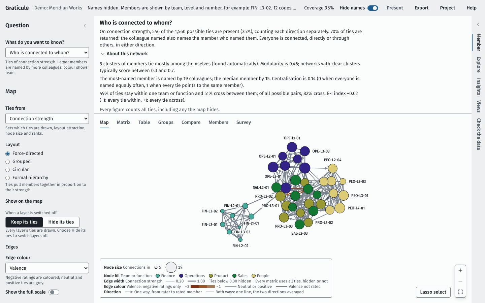

| Question | What it uses | What it shows |
|---|---|---|
| Who is connected to whom? | Connection strength | The map, with larger members named by more colleagues and colour by team. The map opens on this question. |
| How does information reach people? | Advice | The map, with larger members asked by more colleagues; "Show incoming advice ties" ranks them. |
| Where do teams connect, and where not? | Connection strength | The Groups tab: how many ties stay within each team and how many cross to each other team. |
| Who links groups that otherwise rarely meet? | Informal collaboration | The map, with clusters outlined and larger members on more of the shortest routes between colleagues. |
| Whose time do others depend on? | Workflow dependency | The Table's incoming ties, most first, and how much of the demand the busiest tenth receives. |
| Where does work happen outside the formal structure? | Formal and informal collaboration | The map in the formal and informal line styles, over the formal hierarchy when managers are recorded. |
| Where does the network rely on a single route? | Connection strength | The map with bridge ties marked, and the members whose absence would cut others off highlighted. |
| Where are relationships rated negatively, and is that returned? | Valence | The map with negative ratings coloured and drawn however weak the tie. |

If a project does not have the relationship a question needs, or it is switched off or not rated yet, the question says so in the list ("needs advice and information seeking") and, when chosen, explains how to add it. It changes nothing: Graticule never answers with a different relationship under the same title. The demo rates the four core relationships only, so its advice and dependency questions say they need those ratings; the post-merger scenario project (`src/demo/scenario-post-merger.ona.json`) answers all eight.

**Every number has a sentence.** Under the question's title, its figures are read out in words: for example "On connection strength, 546 of the 1,560 possible ties are present (35%), counting each direction separately." "About this network" adds, in the same way, the six network measures (density, reciprocity, separate parts, communities, centralisation and the E-I index) that the question has not already read out. In the member panel each measure has a sentence beside its rank, comparing the person with their colleagues and with their team's median: "Lies on more of the shortest routes between colleagues than any of their 39 colleagues." Every figure counts all ties, including any the map hides.

**From a question to a saved view.** Choose a question, read the sentences, adjust the map if you need to (the range, filters and layout keep the question), and save it in the Views tab: the question becomes the view's caption, ready for a presentation. Choosing another relationship under Ties from is your own analysis rather than the question's, so the title then names the relationship instead.

**Combining layers is advanced.** Several relationships can be combined into one weighted set of ties, the composite, under "Advanced: combine layers" below the map settings. It is closed until you open it, because the weights are a statement of priorities you make, not a measurement (see [Composite weighting](#composite-weighting)).

## Getting started

Open Graticule in a current version of Chrome, Edge, Firefox or Safari on a computer. A tablet works too; on a phone, projects can be viewed and explored but not changed.

The first time you open Graticule it shows a notice about data and consent. Read it before you load any real data: it summarises the points in [Ethics and consent](#ethics-and-consent). You can read it again at any time from Help → Data and consent notice.

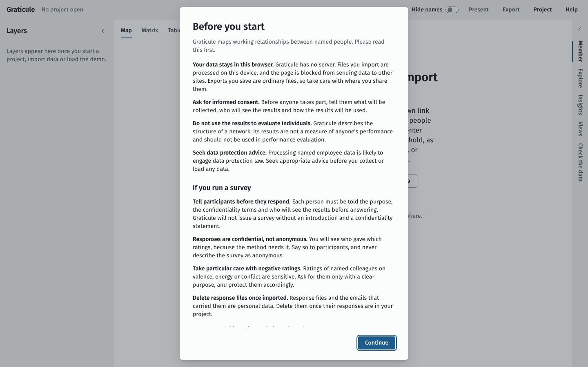

The empty workspace offers four ways in: run a survey, add members by hand (see [Building a roster in Graticule](#building-a-roster-in-graticule)), import survey data you already hold, or load the demo. The demo is a fictional organisation of 40 people in five teams, built to contain a broker between teams, a team that keeps to itself, a pocket of reciprocated negative ratings and a clear mismatch between formal and informal ties. It is the quickest way to learn the tool.

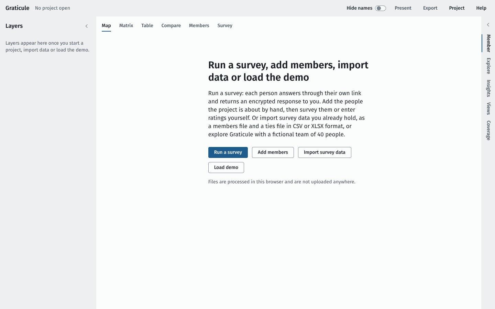

The workspace has three columns: settings on the left (the question, map settings, "Advanced: combine layers" and layers), views in the centre under the question's title (Map, Matrix, Table, Compare, Members and Survey), and details on the right (Member, Explore, Insights, Views and Check the data). While the Members or Survey tab is open, the left column holds the layers only; the weights and map settings are on the Map tab. The top bar holds the coverage figure, the Hide names switch, Present, Export, the Project menu and Help.

### Compact and full layouts

On a laptop-sized window (narrower than 1600 px or shorter than 900 px, and at least 1280 px wide) Graticule uses the compact layout so the map has room. The left column (weights and map settings) collapses to a rail with a button named "Weights and map settings". The right column is always a rail: choosing one of its tabs, selecting a member, or pressing its toggle opens a drawer over the map's right edge, and Escape or the close button shuts it and returns focus to where it was opened. Status messages appear in the top bar, and Lasso select sits with the zoom buttons. On larger windows the full layout shows both columns at once.

Help offers "Layout: automatic" (the default), "Layout: compact" and "Layout: full" to override the choice. The preference is kept in this browser and removed by Clear local data. It does not apply below 1280 px: tablets and phones follow the window's width alone.

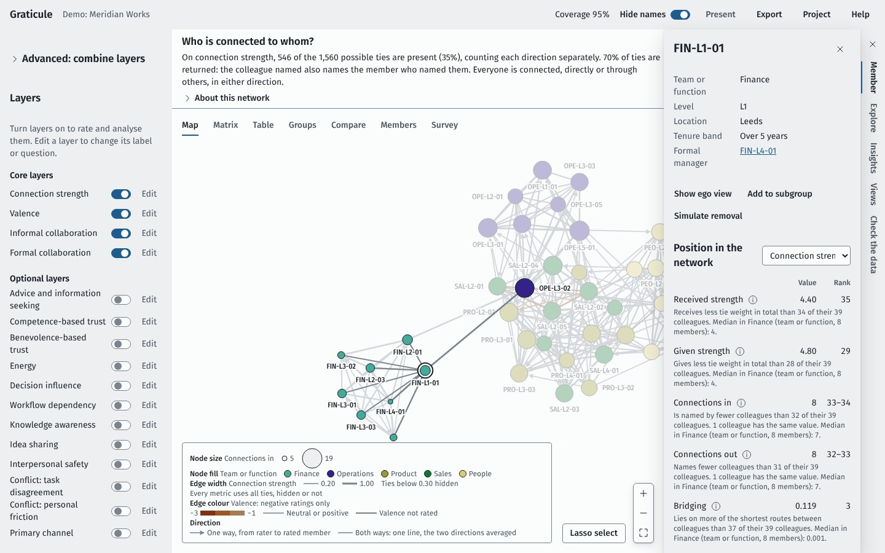

### Projects and local storage

A project is saved as a single file ending in `.ona.json`, which holds the members, layers, ratings, saved views, surveys and settings. Use Project → New project to start an empty one, Project → Save project to download it and Project → Open project… to open it again. Keep project files as you would any personal data; never commit them to a public repository.

Graticule does not keep anything in the browser unless you ask it to. Project → Keep a copy in this browser stores the open project on this device, and the top bar says "Kept in this browser" while it is on. Project → Clear local data… deletes everything Graticule has stored in this browser, including that copy and your preferences.

## Building a roster in Graticule

You do not need a spreadsheet to start. The Members tab builds the list of people a project is about, and keeps it up to date as people join or leave. Choose Add members in the empty workspace, or Project → New project, which starts an empty project and opens the tab. On a phone the tab is not shown, because a project cannot be changed there.

- **Project title.** Shown in the top bar, in file names and on the report cover.
- **Add people.** Type names, or paste a column from a spreadsheet, one name per line, and choose Add people. Each person gets an id (`m001`, `m002`, …) that never changes, because ratings, surveys and saved views refer to people by id.
- **People.** One row per person, with their name and every attribute: team, level, location, tenure band and formal manager to begin with. Each change is saved when you leave the field; leave a field blank if it is not recorded. Values you have typed before are offered as you type, so "Finance" is spelled the same way each time. For the formal manager, type or choose another person's name.
- **Remove.** Removing someone also removes every rating they gave or received, and clears them as anyone's manager. Graticule asks first and says how many ratings will go. If they are on a survey's roster, their responses can no longer be imported, and ratings of them in other people's responses are listed as dropped.
- **Columns.** Rename a column, or add one: a category (such as a site), an ordered category (such as a grade) or an email address for sending survey links. Email addresses are never analysed, shown in analysis views or exported with the analysis. A renamed column keeps its import key, shown under its label, so a members file with that column still matches. Columns cannot be deleted here.

While names are hidden, the tab shows codes instead of names and leaves out ids and email addresses, which could identify people; turn off Hide names to edit them.

With two or more people on the list, set up a survey from the Survey tab or enter ratings yourself in the matrix (see [Entering ratings by hand](#entering-ratings-by-hand)). A members file can still be imported instead, and is quicker for a large organisation whose list already exists in a spreadsheet.

## Preparing data from the templates

If your ratings were collected outside Graticule, prepare two files. Templates in CSV and XLSX are linked from the Import survey data dialog, under "Download a template".

**Members file.** One row per person.

| Column | Required | Contents |
|---|---|---|
| `id` | Yes | A unique identifier, for example `M01`. Avoid names or email addresses, which would appear wherever ids do |
| `display_name` | Yes | The name shown in Graticule |
| `team` | No | Team or function; used for colours, grouping, the insight rules' groups (unless you choose another attribute in the Insights tab) and the codes shown when names are hidden |
| `level` | No | Grade or level; used in the codes shown when names are hidden |
| `location` | No | Location |
| `tenure_band` | No | For example "1 to 3 years" |
| `manager_id` | No | The `id` of the person's formal manager; enables the formal hierarchy layout |
| `email` | No | Used only to send survey links; never shown in analysis views or exports |
| any other | No | Becomes a member attribute you can colour, filter and group by |

**Ties file.** One row per rating, in long format.

| Column | Required | Contents |
|---|---|---|
| `rater_id` | Yes | The id of the person giving the rating |
| `ratee_id` | Yes | The id of the person being rated |
| `variable` | Yes | The layer's key, for example `connection_strength` (the keys are listed in the [method notes](method-notes.md#10-relationship-layers)) |
| `value` | Yes | The rating: a plain number within the layer's scale. Leave it empty if no rating was given, and write `n/a` if the question does not apply to that pair |
| `wave` | No | The survey wave; empty means 1 |

Three rules matter most:

- **An empty value is not a zero.** A rating of 0 means "no connection" or "never" (on valence, "neutral"). An empty cell means the person did not answer, and is counted as missing, never as 0.
- **`n/a` means the question does not apply**, for example the quality of a relationship someone does not have. It is neither 0 nor missing, and it is left out of coverage.
- **Ratings are directed.** A's rating of B and B's rating of A are separate rows, and may differ.

Save spreadsheets as CSV (UTF-8) or XLSX. Graticule reads the first sheet of an XLSX file and the values stored in cells, not their display format.

### Layers

Each relationship you rate is a layer. Four core layers are turned on in a new project: connection strength, valence, informal collaboration and formal collaboration. Twelve optional layers can be turned on in the Layers section of the left column, including advice seeking, two kinds of trust, energy, workflow dependency, interpersonal safety and two kinds of conflict. Edit a layer to change its label or question wording. The full list, with scales and suggested wording, is in the [method notes](method-notes.md#10-relationship-layers).

Ask only about the layers you need. Each extra layer adds a rating per colleague for every respondent.

## Running a roster survey

Graticule can run the survey itself. Each person receives a personal link, answers on their phone or computer, and sends you back an encrypted response by email or as a file. You import all the responses at once. Nothing passes through a server.

The design is a whole-network (roster) survey: every person is asked about their colleagues on the roster. It works only if most people respond, so plan for a high response rate (80 % or more) before you start.

### Before you start

1. List everyone who will take part: add them in the Members tab (see [Building a roster in Graticule](#building-a-roster-in-graticule)), or import a members file (Project → Import survey data…). Add an email column if you want a mail-merge list of links.
2. Turn on the layers you want to ask about, and check their wording in the Layers section.
3. Agree the purpose, who will see the results and how long the data will be kept, and take data protection advice (see [Ethics and consent](#ethics-and-consent)).

### Setting up

Open the Survey tab and choose Set up a survey.

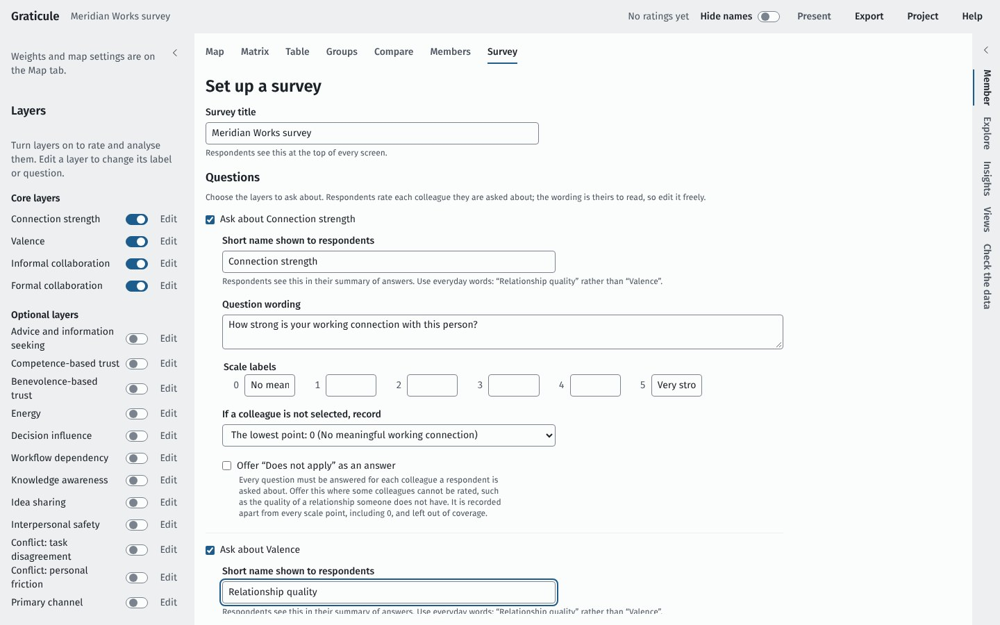

**Questions.** Tick the layers to ask about. For each, set:

- **Short name shown to respondents**, in everyday words: "Relationship quality" reads better than "Valence".
- **Question wording** and **scale labels**, which respondents see while they answer. The default wording for the core layers is:

| Layer | Question | Scale |
|---|---|---|
| Connection strength | How strong is your working connection with this person? | 0 No meaningful working connection … 5 Very strong |
| Valence | Overall, how positive or negative is your working relationship with this person? | −3 Very negative, 0 Neutral, +3 Very positive |
| Informal collaboration | How often do you collaborate with this person outside formal roles, processes or reporting lines? | 0 Never, 1 Less than monthly, 2 Monthly, 3 Weekly, 4 Several times a week, 5 Daily |
| Formal collaboration | How often does your role, a process or a reporting line require you to collaborate with this person? | As above |

- **Offer "Does not apply" as an answer.** Every question must be answered for every colleague a respondent is asked about. Offer "Does not apply" where some colleagues cannot be rated, such as the quality of a relationship someone does not have. It is on by default for signed layers (valence, energy), where 0 means neutral.

**How respondents choose colleagues.**

- **Select colleagues, then rate them** (the default). Respondents first select the people they have a working relationship with ("Select everyone you have a working relationship with." by default; you can edit it), then answer only about them. For each layer, choose what a colleague who is not selected records: the lowest point (for example 0, "Never") or "Does not apply". Unsigned layers default to the lowest point; valence and energy default to "Does not apply", because 0 there would record a neutral relationship nobody reported. Respondents are told what not selecting someone records.
- **Colleagues everyone is asked about.** With selection, tick people every respondent should rate whether or not they select them, for example a leadership team.
- **Rate every colleague.** Respondents answer every question about everyone. This is simplest to interpret but long for large teams.

**What respondents read.** The introduction (the purpose and how the results will be used), the confidentiality statement (who will see the answers and the results) and the return instructions (where to send the response, for example an email address) are all required. Responses are confidential, not anonymous: you will see who gave which ratings. Say so, and never describe the survey as anonymous.

**Estimated time.** Graticule estimates the time each respondent needs (a minute to start, 5 seconds a rating, 2 seconds to consider each colleague when selecting) and warns when it passes the limit, 15 minutes by default. Long surveys are abandoned or answered carelessly: ask about fewer layers, or use selection. The rules are in the [method notes](method-notes.md#completion-time-estimate).

**Links.** A link carries the whole survey and works on its own up to 2,000 characters. Longer surveys use a shared survey file with a short personal link. Choose "Always use a survey file with short links" if your organisation's email rewrites links for security scanning.

### Protecting the responses

Responses are encrypted to a key that only this survey holds. Choose a passphrase of at least 12 characters (a few unrelated words work well), then Create the key. Download the key backup, keep it somewhere safe apart from the project file, and open it again with Choose the backup file to prove the file and passphrase work. Only then can you create the survey.

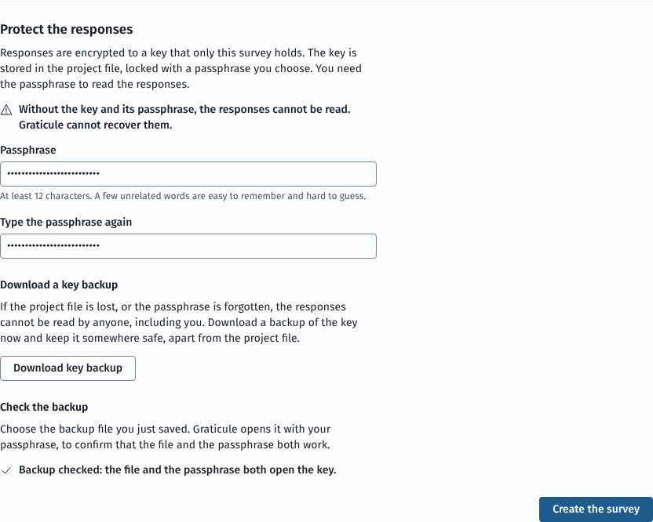

If the key and its backup are lost, or the passphrase is forgotten, nobody can read the responses, including you.

### Sending links

The survey dashboard shows links issued, responses imported, the response rate against the coverage threshold, duplicates and rejected files.

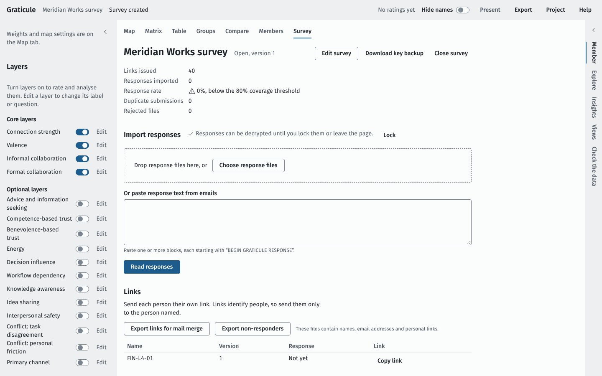

Under Links, copy each person's link, or use Export links for mail merge to save a CSV of names, email addresses and links. Send each link only to the person it names: anyone holding a link can answer as that person. If the survey uses a survey file, send everyone the same file with their own short link. The mail-merge and non-responder files contain personal data by design; delete them when you no longer need them.

### What respondents see

Respondents see a welcome screen with your introduction, the estimated time, the deadline and your confidentiality statement, then a consent step, then a check that the link is theirs. They select colleagues (if you chose selection), answer every question, check their answers, and encrypt them. Their progress is saved on their own device until they send the response.

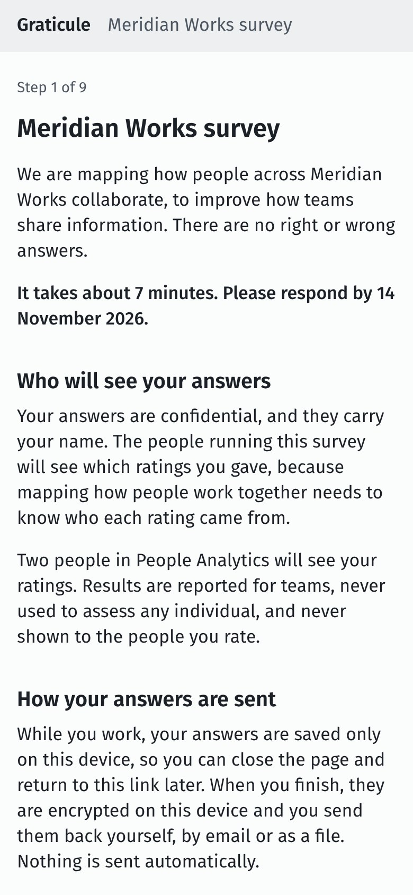

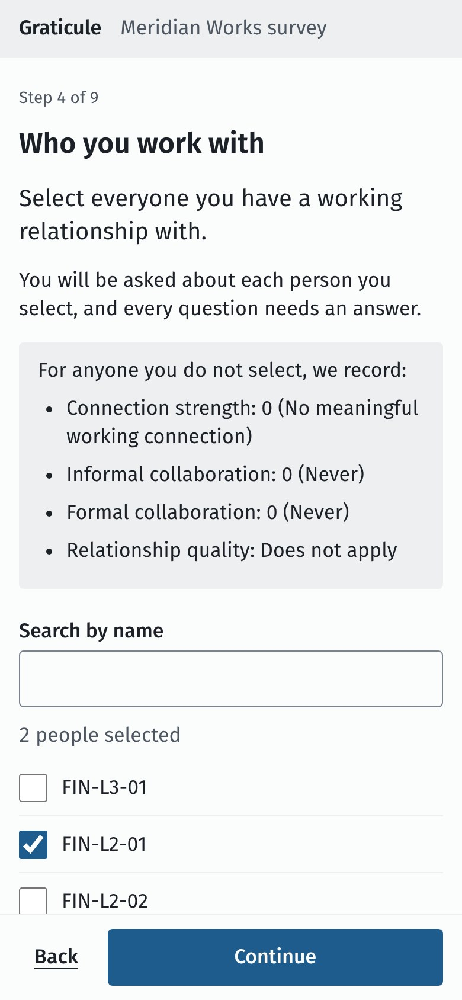

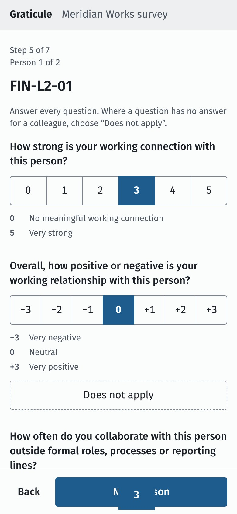

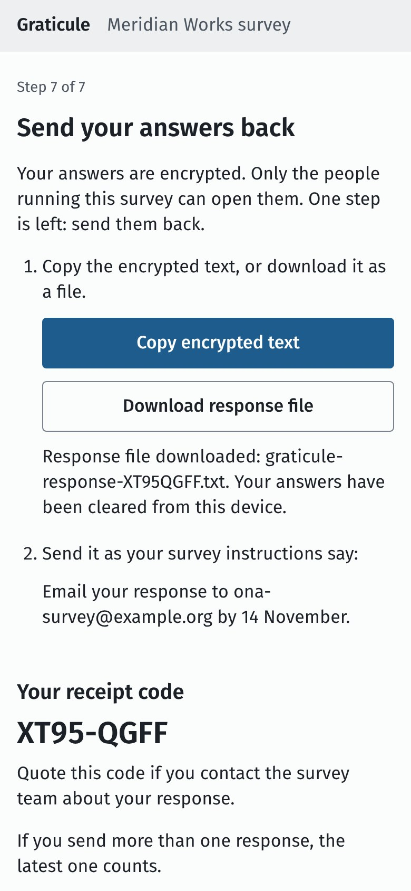

The response is a small text file (named like `graticule-response-7KQ2M4XD.txt`) or a block of text to paste into an email. Each has a receipt code the respondent can quote. [Help for respondents](respondent-help.md) is a one-page explanation you can send with the links.

### Importing responses

On the dashboard, Unlock with the passphrase (it is kept in memory only until you reload or close the page). Drop the response files onto the import area, choose them, or paste response text from emails; several can go at once. Read responses shows a plan before anything changes: responses to import, duplicates, files already imported, rejected files with reasons, and any mapping from an earlier version.

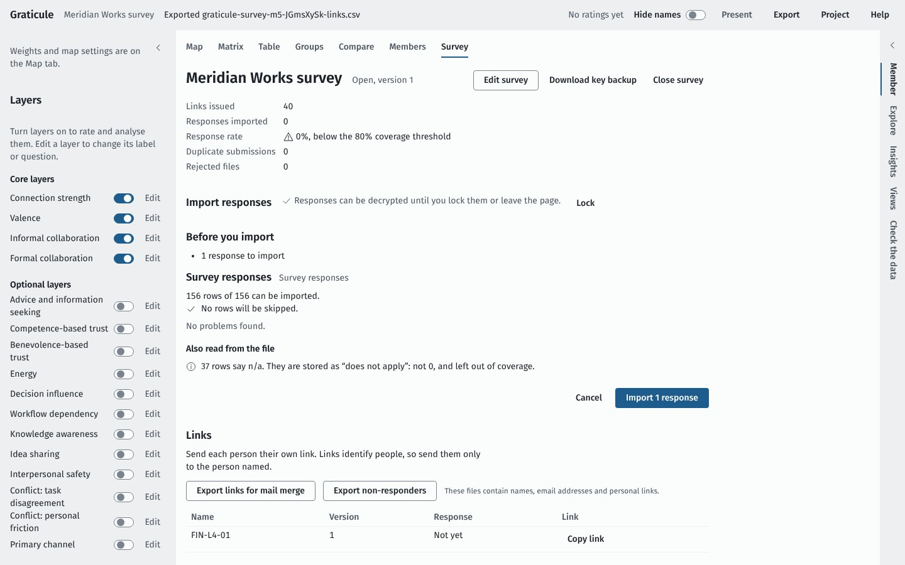

Ratings from responses pass through the same validation report as a ties file, and never overwrite a rating from another source. After importing, delete the response files and the emails that carried them: they are personal data, and their answers are now in your project.

Use Export non-responders for reminders. Close survey stops further imports until you reopen it. If you change who is asked or what they are asked after links have gone out, Graticule creates a new version; earlier links stay valid, and their responses are mapped to the new version by member and layer. The full import rules are in the [method notes](method-notes.md#survey-rules-and-limits).

## Importing and validation

Choose Import survey data (empty workspace or Project menu). Choose a members file and, if you have one, a ties file, then Check files. Importing a members file starts a new project; a ties file on its own is added to the open project, whose members it must name.

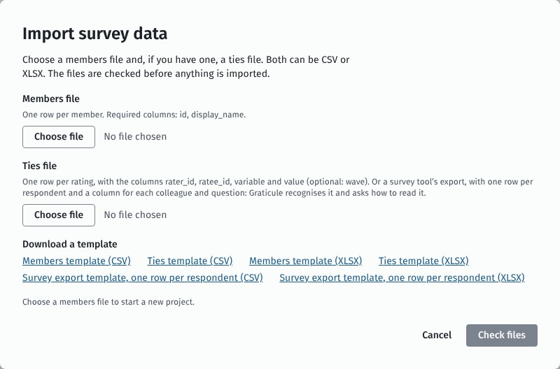

Nothing is imported until the files have been checked. The validation report lists every problem with its row number, as your spreadsheet numbers it (row 1 is the header), and says what to do about it:

- ids that are not in the members file;
- self-ratings;
- values outside the layer's scale;
- duplicate rows (all copies are skipped, so keep one) and ratings the project already has;
- variables that are not layer keys (a close match is suggested);
- values that are not plain numbers, such as "three", "3,5" or "1e2".

Nothing is changed silently. Fix the rows in your file and check it again, or import the valid rows now and skip the rest; the report says how many will be skipped. Notes such as empty values (stored as not rated) and `n/a` values (stored as "does not apply") are listed separately.

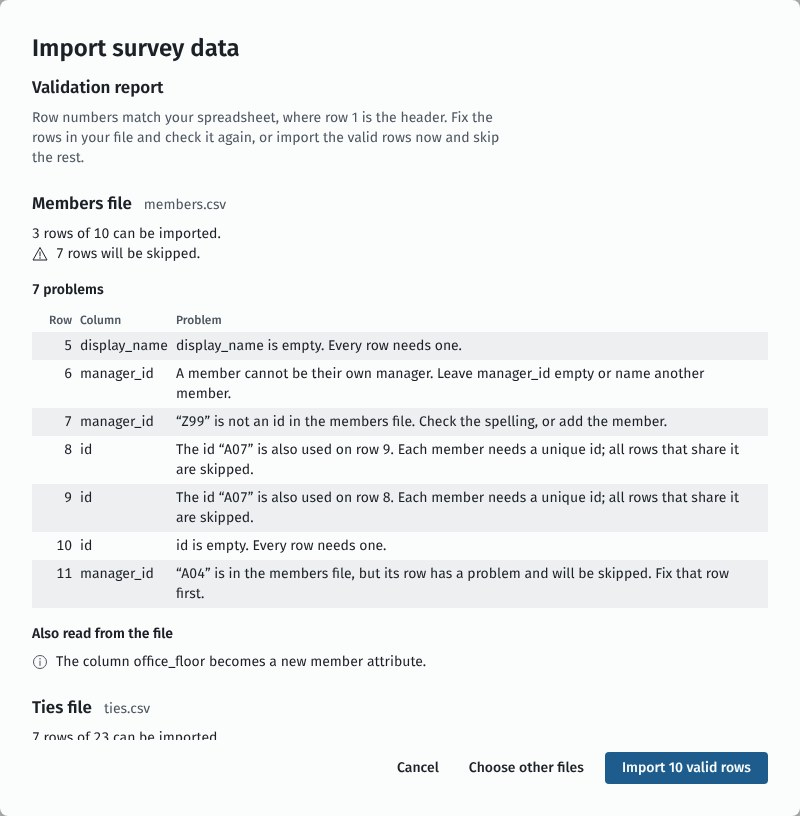

### Entering ratings by hand

The Matrix tab has two modes. Tie strength shows the adjacency matrix. Enter ratings is a grid for one layer, with raters in rows and the people they rate in columns. Move with the arrow keys, type a value and press Enter, press Delete to clear a cell, type `n/a` where the question does not apply, or paste a block copied from a spreadsheet. Self-pairs cannot be edited, and pasted cells that are invalid are skipped and reported.

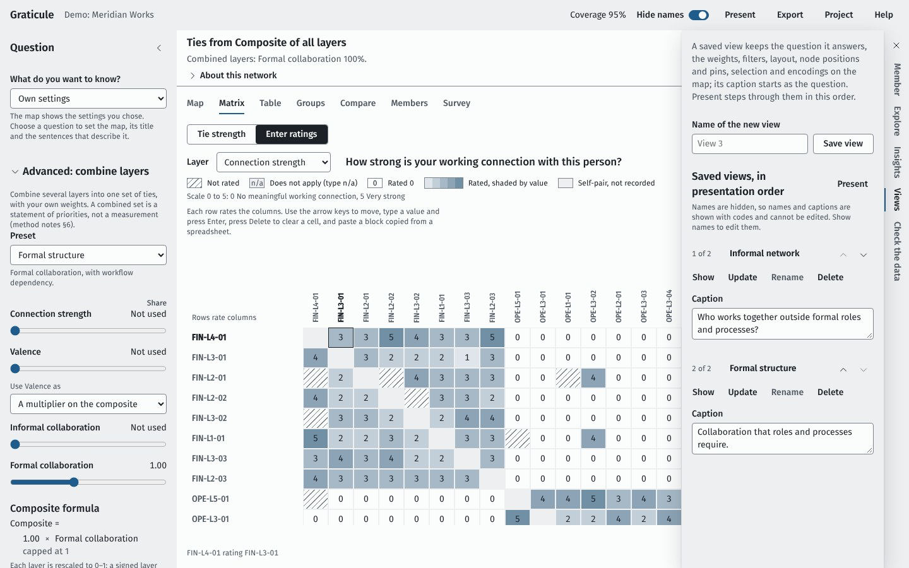

## The map

Once a project has ratings, the Map tab draws the network: each person is a node, and each tie a line.

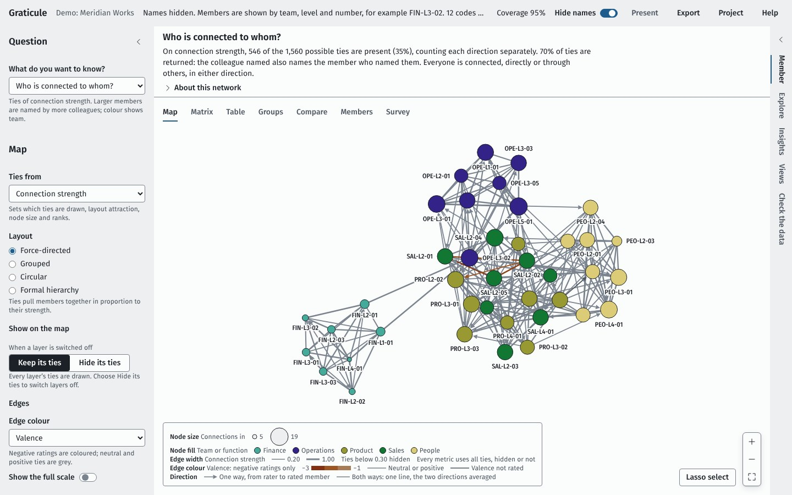

The legend explains every encoding on the map, and is always present. Choose its form with Legend, at the end of the map settings: Condensed (one line per encoding, with the end points of each scale; the default in the compact layout), Full, or Beside the map (its own column, so it never covers the network). Changing the form fits the map to the space left.

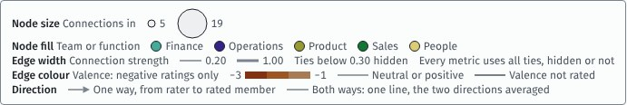

The legend shows:

- **Node size**: the metric you choose under Node size, by value or by rank.
- **Node fill**: an attribute such as team, or detected communities.
- **Edge width**: tie strength on the layer chosen under Ties from, or on another layer you choose; or the same for every tie. A tie with no rating on the width layer is drawn thinnest, in grey, with its own legend entry, so it is never read as 0.
- **Edge colour**: by default, negative valence ratings in orange-brown, with neutral and positive ties in grey; "Show the full scale" adds blue for positive ratings. Ties with no valence rating are dark grey, so they are never read as neutral. Edge colour can instead show another signed layer, the strength of any layer on a blue ramp, whether a tie runs within or between groups, or nothing.
- **Edge style**: formal only (solid), informal only (dashed), both (solid with a dashed line), or neither (dotted). It is off until you choose it under Edge style.
- **Marks**: community outlines and bridge ties, when switched on, and the subgroup, a shortest path or highlighted members.
- **Direction**: in the directed view, a tie rated one way has an arrowhead from the rater to the person rated; a pair rated both ways is one line without arrowheads, whose width and colour combine the two directions by the rule chosen under Direction.

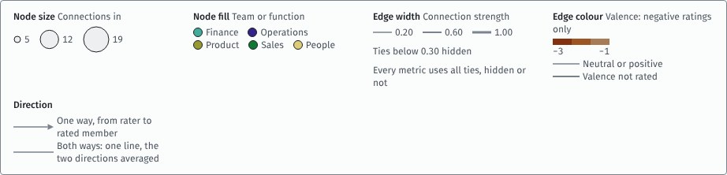

**Map settings** (left column, under Map):

- **Ties from** chooses the layer, or the composite, that sets which ties are drawn, their width, the layout, node size, communities and ranks. A question sets it for you; choosing another layer here leaves the question for your own settings.
- **Show on the map**: with "Hide its ties", a switch for each layer hides the pairs tied on it; every layer starts on. With "Keep its ties" (the default) every layer's ties are drawn.
- **Edges**: Edge colour, Edge width and Edge style, as in the legend above. Each line encoding shows one thing at a time. **Mark bridge ties** puts an orange diamond on each tie whose two members have no contact in common (a local bridge): without that tie, any route between them is longer, or there is none. Bridges are found from every tie of the layer drawn, not only those within the range, and the legend counts the ones drawn.

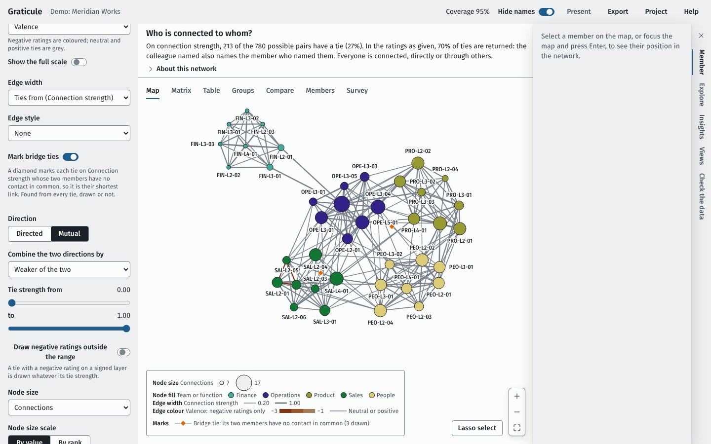
- **Direction.** Directed shows each person's ratings separately. Mutual combines the two directions of each pair, by their average, the weaker or the stronger of the two, or "Both report a tie", which keeps a tie only when each has rated the other above 0. Under the weaker of the two, a tie to someone who did not answer survives, because their missing rating is filled from the one given; under "Both report a tie" it does not. The choice changes the metrics, so it is stated in every export.
- **Tie strength from** and **to** draw only the ties whose strength lies within the range, both ends included; the metrics still use every tie. Set from 0.30 to 0.50, for example, to see only the middling ties. The map opens at 0.30 to 1.00, so the weakest ties are hidden, and the legend says which ties are hidden; set the range to 0 to 1 to draw every tie. From can never be above to: moving one slider past the other moves both. Showing an insight on the map draws every tie, and a saved view keeps its own range.
- **Draw negative ratings outside the range** (when valence or energy is enabled) also draws every tie that carries a negative rating, however weak. With valence as a multiplier on the composite, a negatively rated tie is weakened and often falls below 0.30, so it would otherwise be hidden.
- **Node size**, with **Node size scale** by value (area in proportion to the value) or by rank (area in proportion to the rank, so one member with a very high value does not leave everyone else small), **Node fill**, **Outline communities** (a grey outline round each community found on Ties from, while the fill shows an attribute, so communities that cross teams are visible), **Filter** (by any attribute) and **Search**.
- **Colours**: the scale for signed layers (orange-brown to blue, the default; purple to green; or red to blue), and a colour for each value of the node-fill attribute. Pinning a value to one of the eight colours keeps it the same in every view and presentation; values left on Automatic take the free colours in order. Only palettes that stay distinguishable under the common colour-vision deficiencies are offered, which is why there is no free colour choice. The choices are saved with the project and followed by every export.
- **Layout**: force-directed (ties pull people together in proportion to their strength), grouped by an attribute, circular by group, or formal hierarchy (managers above their reports, with informal ties drawn over it; it needs a `manager_id` column).

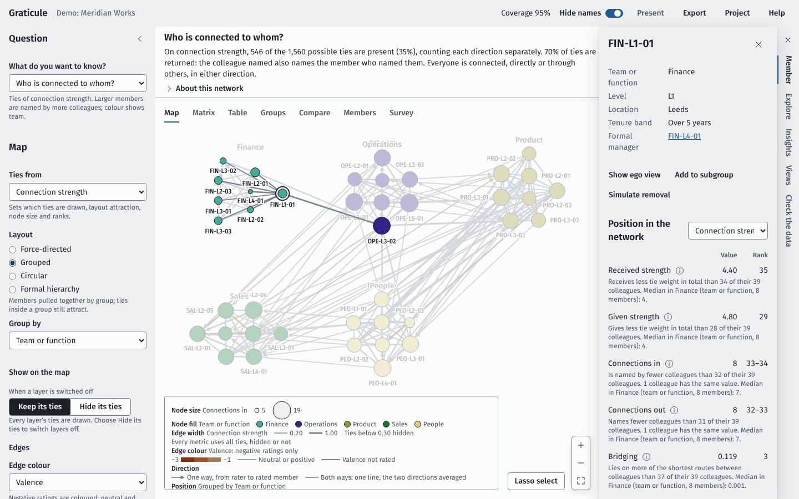

**Interaction.** Hover over a member to highlight their ties; click to open the member panel. Drag a member to pin them, and double-click to release. Scroll or use the buttons to zoom, and Fit to view to see everyone. Shift-click, or Lasso select, adds members to a subgroup.

**Keyboard.** Tab to the map, then use the arrow keys to move to the nearest connected member in that direction. Enter opens the member panel and Escape closes it; Shift and Enter adds a member to the subgroup; plus and minus zoom; 0 fits the map. A table of the members and ties shown is available to screen readers.

### Linked views

Selecting a member, a subgroup, a filter or an ego view applies to every view.

- **Matrix → Tie strength**: an adjacency matrix, shaded by tie strength, which can be ordered by name, attribute, community or a metric.
- **Table → Metrics**: every member's metrics, sortable by any column. Export table saves it as CSV. Rank stability recalculates a metric many times, each time leaving out some members, and shows the range each rank falls in.
- **Table → Incoming ties**: a ranked bar chart of how many colleagues name each member on a chosen layer (advice first, then workflow dependency, then Ties from), most first, with each member's share of all ties received. A line marks where the top 10 % of members ends (where several members receive the same number at that point, member order decides which are above the line; the share is the same either way), and a sentence above says what share of all ties they receive against an even spread. It is a table, so a screen reader reads it row by row; filters and the ego view choose who is listed.
- **Groups**: ties within and between groups. Choose "Group by" (any category attribute, such as team, location or level, or Community, the groups detected on the layer) and "Ties from". The matrix shows, for each group and each pair of groups, the share of the ties possible that exist, shaded from fewer to more; in the directed view rows give and columns receive. Arrow keys move between cells and a sentence names the cell ("Finance to Sales: 4 of 64 possible ties, 6%"). Enter makes the row's group the subgroup in every view, and Shift and Enter makes it both groups of the cell. The group map draws one circle per group, sized by its members, with thicker lines between groups that share more of their possible ties; click a circle to choose that group. The table lists each group's members, ties inside, ties leaving and E-I index; press a group's name to choose it, and again to clear the subgroup. Every member and tie counts, whatever the map's range and filters. The PDF report's table of ties within and between groups uses the grouping chosen here.
- **Compare**: two layers side by side on the same positions, with their overlap; or formal against informal collaboration, classifying each pair as formal only, informal only, both or neither.

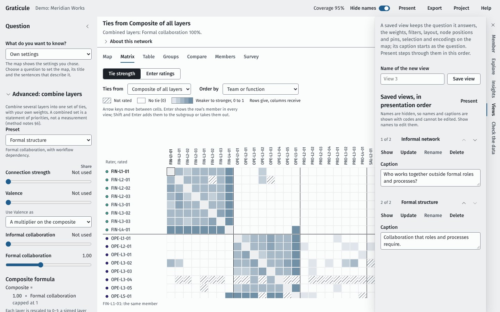

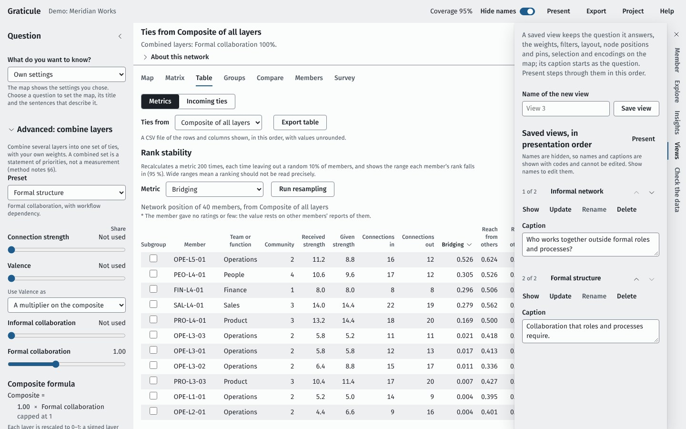

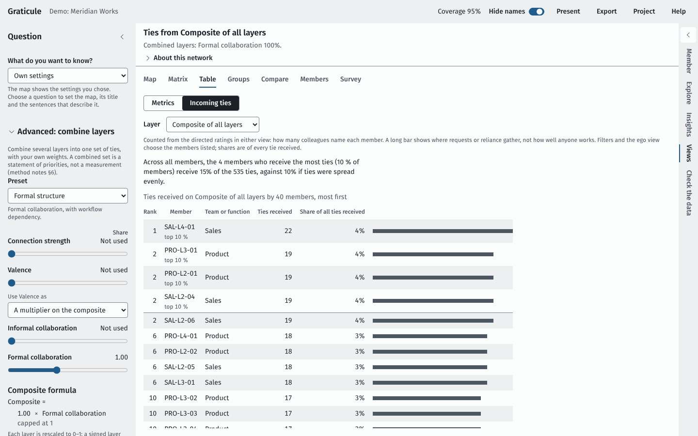

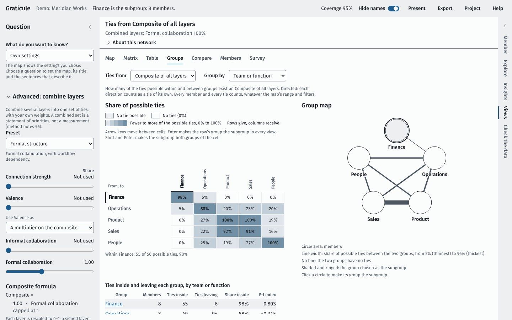

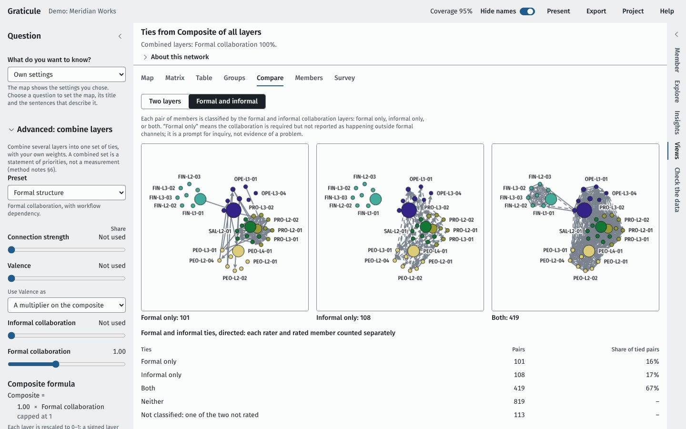

### Explore

The Explore tab (right column) holds four tools, all using the ties from the layer the map draws:

- **Ego view**: one member and everyone within one or two steps of them.
- **Shortest path**: the strongest route between two members, drawn on the map with its distance and steps.
- **Subgroup**: the density of ties inside a group you select, compared with its ties to everyone else, and its E-I index.
- **Resilience**: remove members in a simulation and compare the network before and after (separate parts, pairs that can reach each other, average distance). Nothing in the project changes.

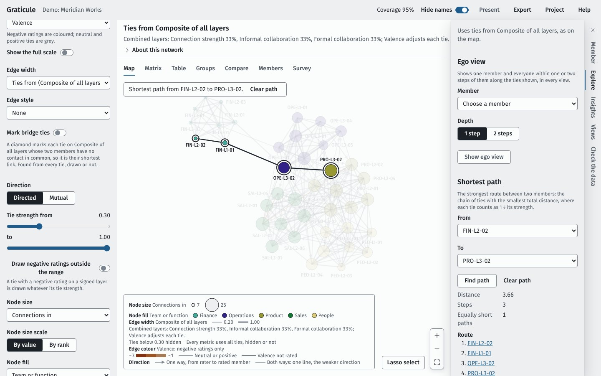

## Reading each metric

Open a member's panel to see their position in the network: each metric's value and rank (1 is the highest), for the layer you choose, with a sentence under it that compares the person with their colleagues ("Is named by fewer colleagues than 32 of their 39 colleagues") and gives their team's median. Constraint reads the other way: a low value is a more open network, so the sentence says "a more open network than …". The information button beside each metric gives its meaning, caveats and technical name. The formulas are in the [method notes](method-notes.md#3-node-metrics).

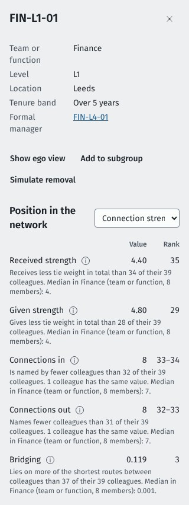

| In the app | What it tells you | Read it with care because |
|---|---|---|
| Received strength / Given strength (Strength when mutual) | How much tie weight a person receives from others, or gives | Given strength reflects how generously someone answered as much as their relationships |
| Connections in / out (Connections when mutual) | How many people a person has a tie with, whatever its strength | A weak tie counts as much as a strong one |
| Bridging | How often a person lies on the shortest routes between others: someone who connects parts of the network that are otherwise far apart | It assumes things travel along shortest paths; one tie can move it a great deal |
| Reach from others / Reach to others (Reach when mutual) | How easily a person is reached by, or reaches, everyone else | Unreachable people add nothing, so it stays defined in a split network |
| Ties to the well connected | Being tied to people who are themselves central | Defined only for the largest group of people who can all reach each other |
| Constraint | How much a person's contacts are tied to each other: high means a closed, redundant circle | People with few contacts score high by construction |
| Non-redundant contacts | The number of contacts who are not tied to each other | At most the number of contacts |
| Local clustering | How many of a person's contacts are tied to one another | Zero for anyone with fewer than two contacts |

A value can be "Not defined", with the reason, for example for someone with no ties on that layer. It is never shown as 0.

A value marked * rests on other people's reports, because the member gave no ratings or fewer than half of the ratings possible: their own view of their ties is missing. The note under the metrics says which, and the metric's information button gives the reason. In the directed view the incoming metrics (received strength, connections in, reach from others) do not depend on the member's own answers and are not marked. The Table labels such members and marks their values the same way, and the member metrics export gives the reason in its last column. On the map, a member who gave no ratings is drawn hollow, with its own legend entry.

**Network measures** (read out under "About this network" above the views, and in the network metrics export, the report and the Compare tab): density (the share of possible ties that exist), reciprocity (how often ties are returned), average clustering, components (separate parts), communities found by the Louvain method with their modularity, centralisation (how dominated the network is by one person), the E-I index and cross-group density (whether ties stay within groups or cross between them), structural balance on signed layers, and layer overlap. Each is defined in the [method notes](method-notes.md#4-network-metrics).

**Ranks are not scores.** A rank orders positions in this network, on this layer, from these answers. Positions have many causes (role, tenure, location, workload, who answered the survey), and a small change in ties can change a rank. Run Rank stability in the Table to see how much each rank depends on exactly who took part; a wide range means the ranking should not be read precisely.

### Check the data

Read this tab before the insights. It says whether the data can bear a conclusion, and its first section is the **data-quality statement**, a few sentences written from the checks below that name no one. The same statement opens a presentation, appears in the Export dialog and is printed on the report's cover.

- **Coverage**: the share of possible ratings that were given, overall and per rater, and where the ratings came from (survey responses, imported files or matrix entry). Below the threshold, 80 % by default, a warning stays under the top bar: whole-network metrics may be unreliable, because a missing rating looks like a missing tie. You can change the threshold here if a lower rate is expected. Near the threshold the figure keeps one decimal place, so 79.6 % is never shown as 80 %. Until the project has its first rating, for example while a survey is being set up, the top bar says "No ratings yet" instead of giving a warning. Ratings saved without a record of where they came from, such as the demo's, are listed as "Not recorded".
- **Coverage by group and by level**: coverage for each team (or the attribute chosen under Group members by in the Insights tab) and each level, with how many people gave ratings and the share of their ties not reported back. Overall coverage can pass the threshold while one group is mostly silent, such as a night shift.
- **People who gave no ratings or few**: named here for you only. Their results rest largely on other people's reports. Fewer than half of the ratings possible counts as few.
- **How each person rates**: each person's mean rating (every rating rescaled to 0 to 1), its spread, how much of each scale they used and the share of colleagues they report a tie with. A note marks someone who gave everyone the same answer, who rates higher or lower than most (0.15 or more from the median), or who reports ties with many more colleagues than most. These describe rating habits, which carry into given strength and into averaged ties; someone who really is closer to more people also rates higher, so read them as a prompt, not a finding.
- **Ties reported by one side only**: of the ties someone reported, where the other person also answered, how many were not reported back.

The checks change no figure. The definitions and thresholds are in the [method notes](method-notes.md#13-data-quality-checks).

**Adjust the analysis**, at the end of the tab, offers four options for what the checks show. Each changes the whole analysis (map, tables, insights and exports), is saved with views, and is stated in exports. All are off until you switch them on.

- **Count a tie only when both report it**: the Direction rule "Both report a tie" (above).
- **Leave out people who gave no ratings**: their values that depend on their own ratings show as not defined, and the rules on brokers, peripheral members and possible overload neither name nor count them. Otherwise those values are shown and marked *.
- **Reconstruct their ties from colleagues' ratings**: on relations both people share (connection strength and formal and informal collaboration, unless you change "Mutual by nature" when editing a layer), someone who gave no ratings is given each colleague's rating of them as their own. Reconstructed ratings are labelled in the member panel, the legend and the member metrics export.
- **Compare each person's ratings with their own**: on unsigned layers, each person's ratings are replaced by their rank among their own ties, so someone who rates everyone high and someone who rates everyone low count alike. Which ties exist does not change.

**Preview the effect on the insights** runs the analysis again with each option switched, without changing the screen, and lists the observations each would change (for example a broker no longer named, or a silo found), with the composite's tie count when it changes. Options that cannot change anything, such as leaving out non-respondents when everyone answered, say so. The methods are in the [method notes](method-notes.md#14-data-remedies).

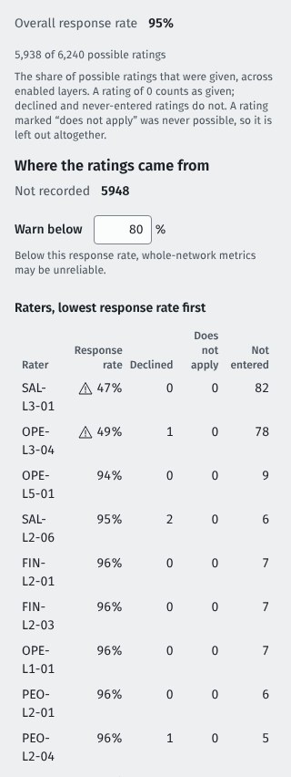

### Insights

The Insights tab lists rule-based observations: potential brokers, only routes between groups, peripheral members, possible overload, concentrated demand, silos, negative clusters, negative ratings not returned, and formal ties with no informal counterpart (and the reverse). Each is written as a question to explore with the people involved, never as a finding about anyone, and each shows the rule and thresholds that produced it. Under the members named, an observation says what most of them have in common when it is more common among them than in the project as a whole, for example "Three of the five share tenure band Under 1 year", and marks anyone named who gave no ratings. Show on the map sets the map up to show the observation; Save as view keeps it for a presentation. The rules are in the [method notes](method-notes.md#8-insight-rules).

**Group members by** chooses the attribute the only-routes, concentrated-demand, silo, formal–informal and negative-ratings rules compare: team by default, or any other category, such as a programme in a matrix organisation or the former organisation after a merger. The choice is saved with the project, and each rule names it.

A few things the rules do so that realistic data does not mislead:

- Silos are checked only when there are at least two groups of three or more members; with one group, every tie is inside it by definition. The conflict layers are not read, because conflict between colleagues stays inside a team by nature.
- Potential brokers need a bridging score of at least 0.05, and peripheral members must be at least 10 % below the median, so small differences in a close-knit team are not reported.
- At most five peripheral members are listed, and the question says how many were found. Peripheral members who make up at least half of a silo group are named with that group instead of twice.
- Only routes between groups names a group of three or more whose ties with every other group are held by at most two of its members, and at most half the group, on the composite or any working layer; and any member through whom alone three or more colleagues are linked to the rest (a cut point). Its view marks bridge ties.
- Concentrated demand reads advice and workflow dependency: it is observed when the 10 % of members named most receive at least 25 % of all ties, or when, within a group of five or more, the group's own top members receive at least 2.5 times an even share. Possible overload stays beside it: one describes how demand is spread, the other names who receives most.
- Negative ratings not returned counts negative ratings whose reverse is neutral, positive or missing, by group. Its view draws negative ratings whatever the tie strength. A one-way rating can reflect how someone rates in general, or a colleague who did not answer, as much as the relationship.

The conflict layers have weight 0 in the composite by default, so frequent conflict does not make a stronger tie; give them a weight in Custom if you want them counted.

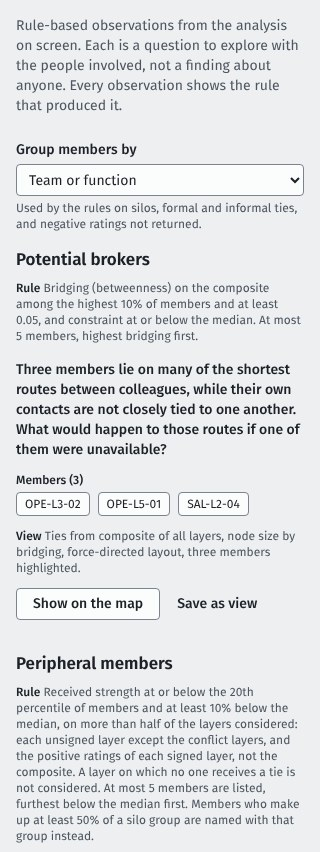

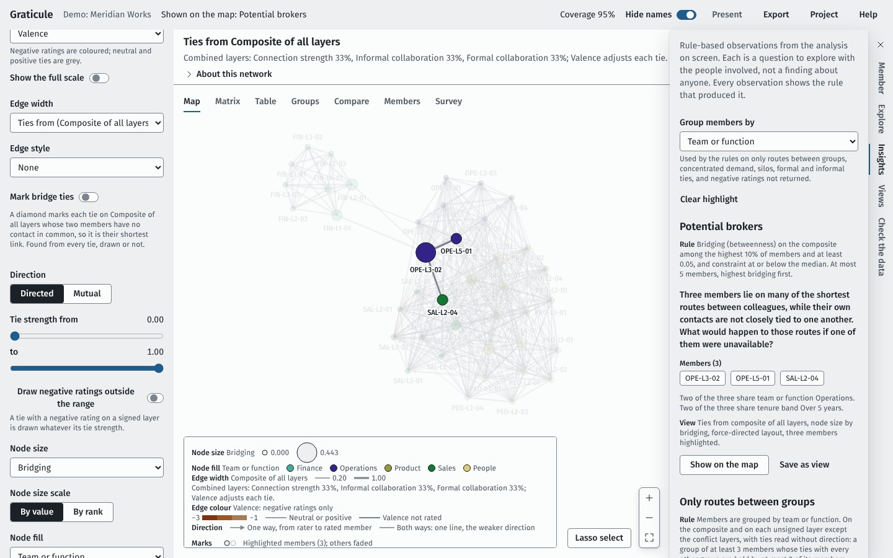

## Composite weighting

Different questions need different relationships, and the questions above each use one. The weight panel, under "Advanced: combine layers" in the left column, combines several layers into one composite score per pair, which then drives the layout, edge width, node size and all rankings when Ties from is set to the composite. Open the section and choose "Draw ties from the combined layers" to use it. While it is used, its weights are stated above the map and in the legend, and so in every export of the map: for example "Combined layers: Connection strength 33%, Informal collaboration 33%, Formal collaboration 33%; Valence adjusts each tie."

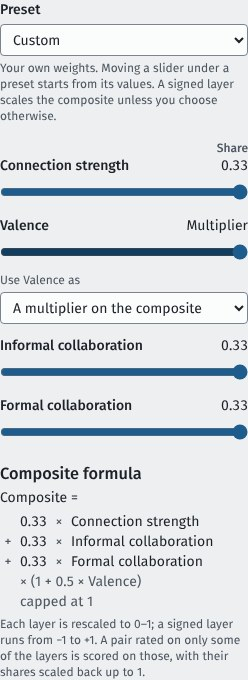

- **Presets.** Formal structure (formal collaboration, with workflow dependency), Informal network (informal collaboration, with advice and idea sharing) and Relationship health (connection strength, positive energy, benevolence-based trust and interpersonal safety, scaled by valence). Layers a preset does not use get weight 0. The preset values are in the [method notes](method-notes.md#presets).
- **Sliders.** One per enabled layer. Each layer is first rescaled to 0–1, and the weights are scaled to add up to 1, so only their proportions matter; each slider shows its share. Moving a slider switches to Custom, starting from the preset's values.
- **Signed layers** (valence, energy) can be used as positive ratings only, as a filter (a negative rating removes the tie), or as a multiplier (a negative rating reduces the composite by up to half, a positive one raises it by up to half). Unless you or a preset choose otherwise, a signed layer is a multiplier, so a positive rating alone does not create a tie.
- **The formula** beneath the sliders shows exactly what is being calculated, in plain notation.

When the weights change, members move smoothly to their new positions so you can see what moved (unless your system asks for reduced motion). The composite is a statement of priorities, not a measurement: say which weights you used whenever you show it. The formula is in the [method notes](method-notes.md#composite).

## Saved views and presentations

A saved view keeps the map as it is: the weights, filters, layout, node positions and pins, selection and encodings. Set up the map, then in the Views tab type a name and Save view. A view saved while a question is chosen keeps the question, and takes it as its caption. Add or edit a caption for each view: it is shown under the map when presenting, and about 60 characters per line reads well from the back of a room. Use Show to restore a view, Update to replace it with the map as it is now, and the arrows to change the order.

A good presentation is a short sequence of views, each answering one question: for example the informal network, then the formal structure, then one insight shown on the map. Save an insight's view straight from the Insights tab with Save as view; its caption is the insight's question.

Choose Present (top bar or Views tab) to show the views full screen, with the title, the map, the legend and the caption. A presentation opens with "About the data", the data-quality statement, so the audience hears what the data can bear before the first view. Use the right arrow, Page down or Space for the next view, the left arrow or Page up for the previous one, Home for the opening and End for the last view, and Escape to leave. Moving the pointer shows a small control bar, which includes Hide names.

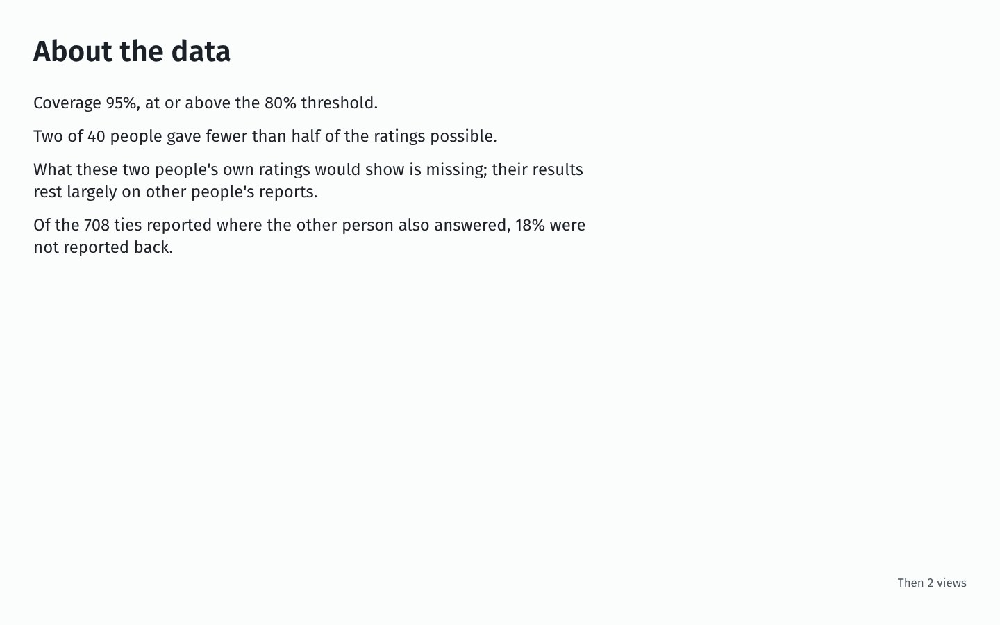

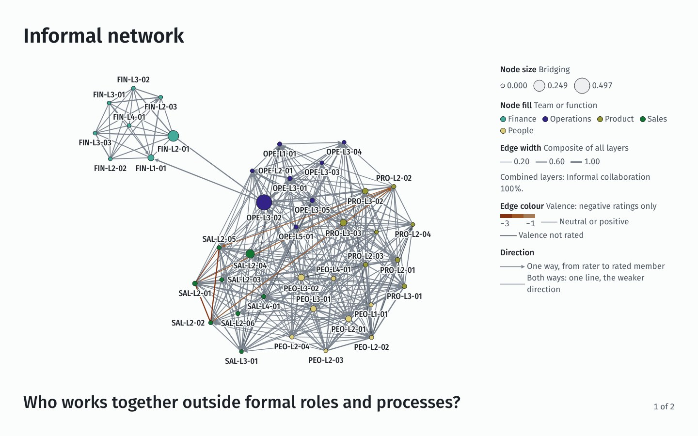

**Hide names** (top bar, presentation controls and Export dialog) replaces every name with a code made from the team, level and a number, for example FIN-L3-02, in every view and export. Codes of small teams can still identify someone; Graticule says how many codes belong to a team and level with fewer than three members.

## Exports

Export (top bar) opens the export dialog. Under its settings it shows the data-quality statement as the exports carry it; the report prints it on its cover. Every export follows its two settings:

- **Hide names**: names are replaced by codes, including names written in captions and titles.
- **Leave out valence, energy and conflict**: these layers hold negative ratings of named colleagues. When left out, the exports are calculated again without them, so no figure depends on them. The setting is saved with the project.

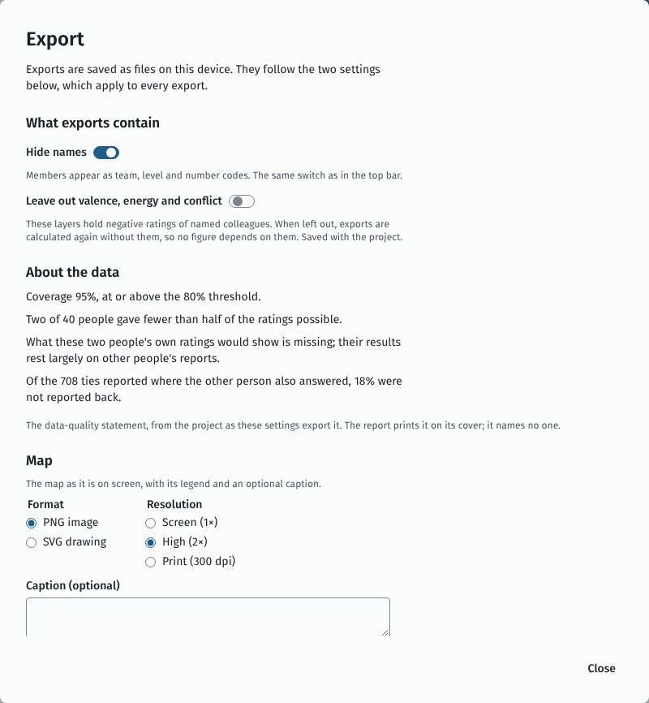

| Export | Contents |
|---|---|
| Map (PNG or SVG) | The map as on screen, with its legend and an optional caption. PNG at screen, double or print resolution (300 dpi across A4 landscape); SVG with its fonts embedded, for print and editing |
| Member metrics (CSV) | Every member's metrics on every layer and the composite, one row per member and layer, unrounded, with why a value is not defined or, for someone who gave no or few ratings, that it rests on others' reports |
| Network metrics (CSV) | Density, reciprocity, components, communities, centralisation, mixing between groups and more, per layer |
| Formal and informal ties (CSV) | Every pair classified as formal only, informal only, both or neither |
| Table (CSV, from the Table tab) | The rows and columns shown, in their order |
| Report (PDF) | The data-quality statement on the cover, the map, key network metrics, insights, method notes, data coverage with survey response rates, and an ethics statement. For a signed layer's negative ratings, the metrics table gives ties, density and reciprocity, but not separate parts, communities, modularity or the centralisation of bridging, which describe how a network holds together |

In CSV files an empty cell means not defined or not rated. File names end in `-codes` when names are hidden and `-no-signed` when those layers were left out. Exports are ordinary files: store and share them as personal data unless names are hidden and you are sure no code identifies anyone.

## Ethics and consent

Network data about named colleagues is sensitive. Before collecting or loading any:

- **Seek data protection advice.** Processing named employee data is likely to engage data protection law. Agree the lawful basis, retention period, who has access and how results will be reported before you start.
- **Ask for informed consent.** Tell participants what will be collected, why, who will see the results and how they will be used, before they take part. Graticule will not issue a survey without an introduction and a confidentiality statement.
- **Be honest about confidentiality.** Responses are confidential, not anonymous: the analyst sees who gave which ratings, because a whole-network analysis needs it. Never describe the survey as anonymous.
- **Do not use the results to evaluate individuals.** Graticule describes the structure of a network. Its results are not a measure of anyone's performance, and should not be used in performance evaluation or decisions about individuals. Treat each observation as a prompt for conversation with the people involved.
- **Take particular care with negative ratings.** Valence, energy and conflict ratings of named colleagues need a clear purpose. Ask for them only if you need them, restrict who sees them, and use Leave out valence, energy and conflict when exporting for a wider audience.
- **Hide names for wider audiences**, and check the small-group note: a code can still identify someone in a small team.
- **Delete what you no longer need**: response files and the emails that carried them once imported, mail-merge and non-responder lists after the survey, and project files at the end of the agreed retention period. Project → Clear local data removes anything kept in the browser.
- **Mind the limits of the data.** Below the coverage threshold, whole-network metrics may be unreliable. Every metric has caveats, listed in the member panel and the [method notes](method-notes.md).

Your data stays in the browser: Graticule has no server, and its Content Security Policy blocks the page from sending data to other sites. That protection ends when you save a file: exports and project files go wherever you put them.

## Getting help

Help → User guide, Method notes and Help for respondents open these documents inside Graticule; Help → Licence shows Graticule's licence statement and links to the third-party notices; Help → Data and consent notice reopens the first-run notice.

Graticule is not open source: it is copyright Maxted Neal, all rights reserved. You may use the published site to evaluate it. Registered charities, and non-commercial research and teaching, can ask for a free licence, and businesses and public-sector bodies for a paid one, at maxtedneal@gmail.com.

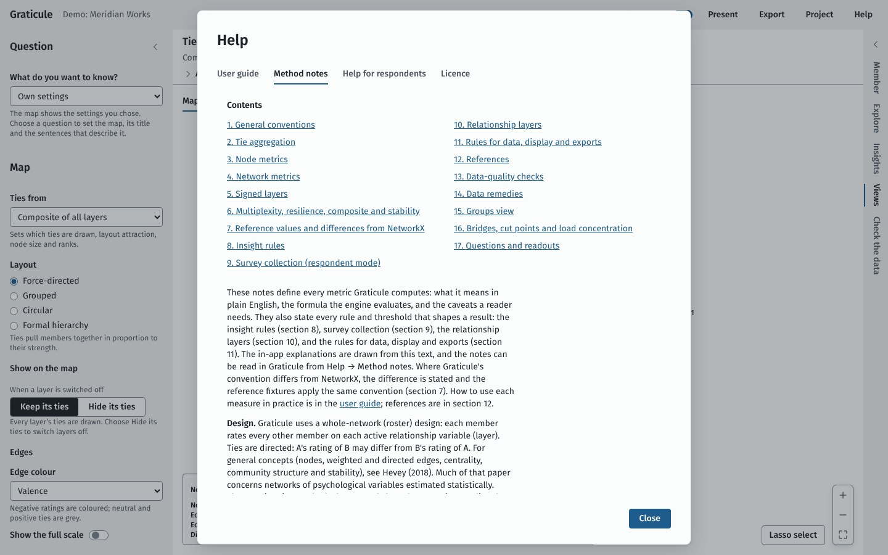
